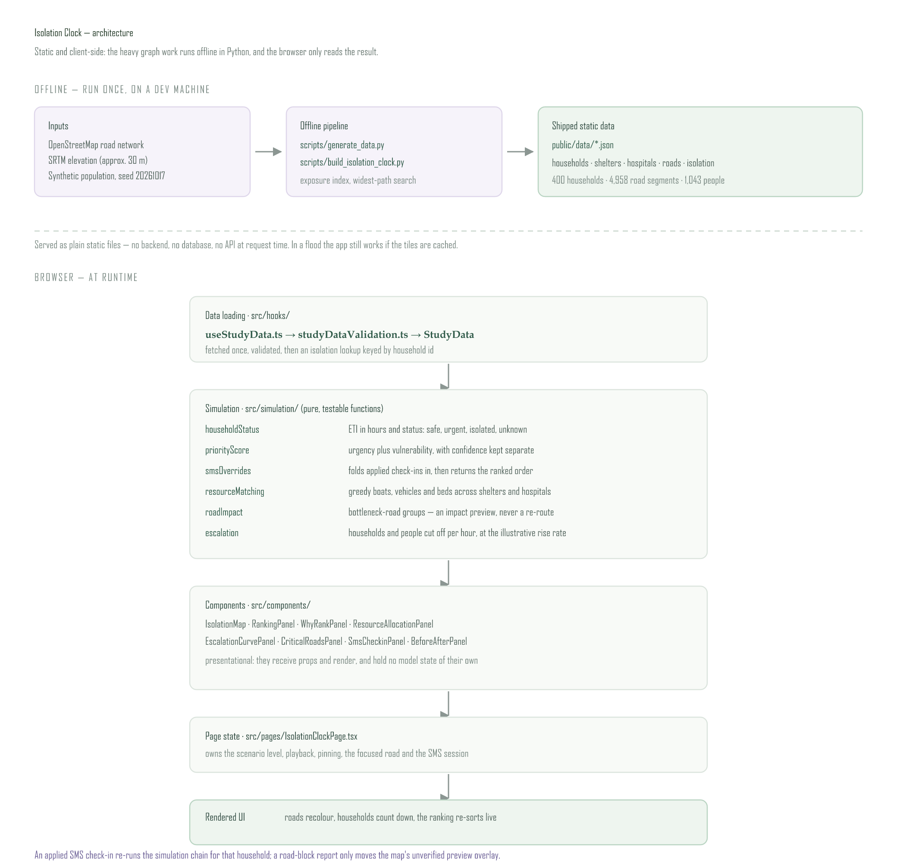
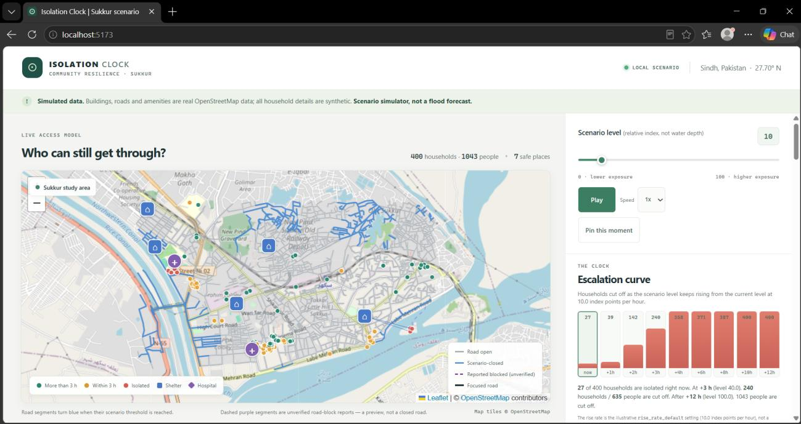
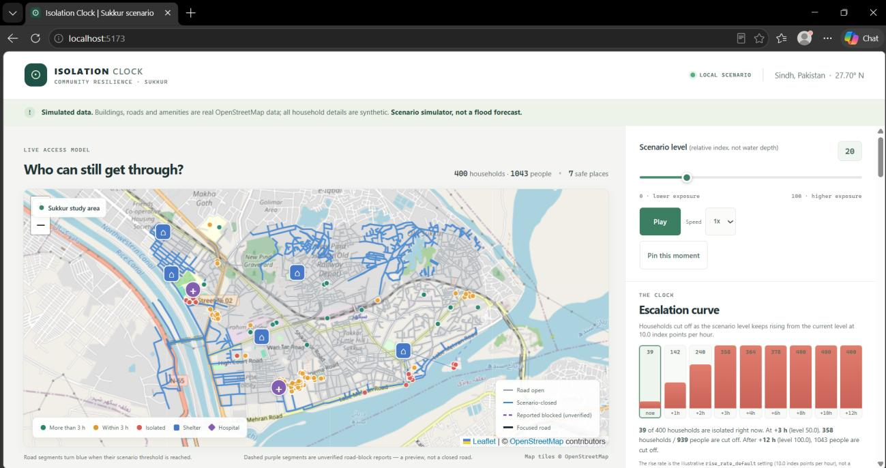
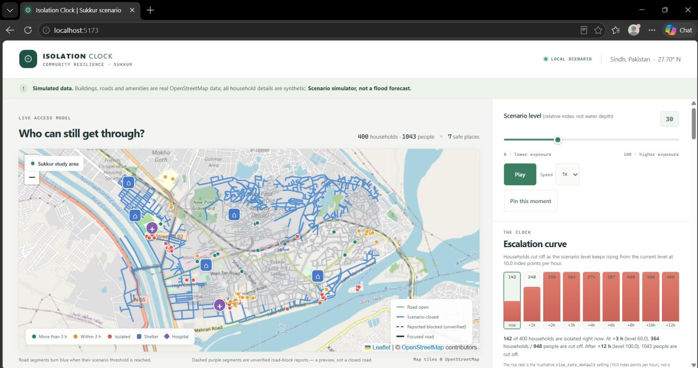
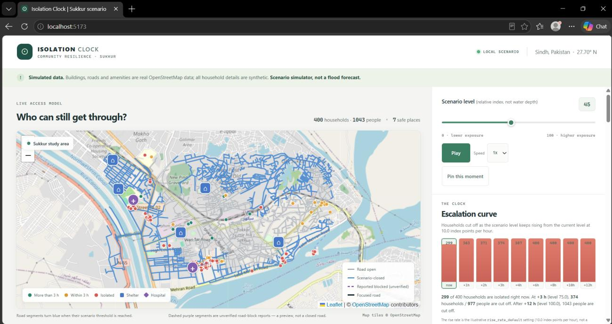
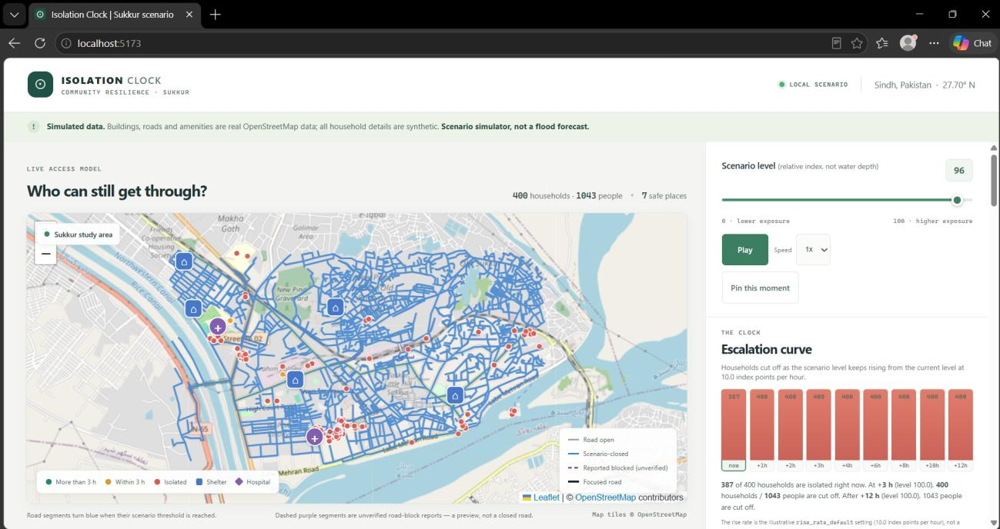
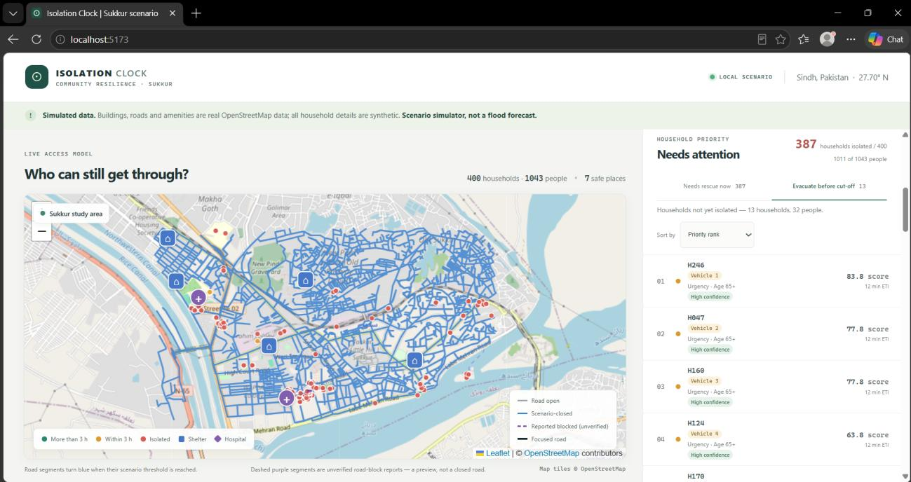
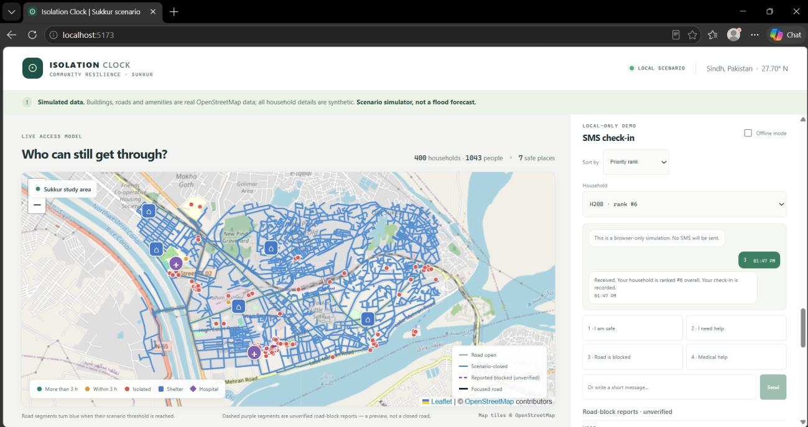

# ⏳ Isolation Clock

> **Not who is flooded — who is about to be cut off, and how many hours they have.**

**Isolation Clock** is a scenario simulator for flood rescue coordination in **Sukkur, Sindh,
Pakistan**. Instead of ranking households by *current* flood depth, it ranks them by **time until
isolation** — how long before every road out of their neighbourhood is under water and they can no
longer be reached.

A frail person on dry ground whose only road floods in 90 minutes outranks someone already standing
at a shelter door. Household details are synthetic by design; buildings, roads and amenities for
the study area come from real OpenStreetMap map information.

Built for **CODE//CONNECT'26 — Vibe Coding Hackathon** (Problem 01, Disaster Response).

**▶ Live app: <https://isolation-clock.netlify.app/>** — static deploy on Netlify, no account or
API key needed to open it.

---

## 🎬 Demo video

A full walkthrough of the working app — recorded by **Rabia Chandio**.

▶ **[Watch the demo](media/demo-walkthrough.mp4)** (2 min 21 s, MP4, plays in the browser)

It follows the scenario slider across the sweep, the ranking re-sorting live, one household's *why*
panel, the suggested allocation split, the before/after comparison and the SMS check-in simulator.

> The same disclaimer applies on screen as here: this is a **scenario simulator, not a flood
> forecast**. Households are synthetic, the roads are real OpenStreetMap data, and a simulated SMS
> check-in is **unverified** — it is not evidence.

---

## 🎯 The Problem We Chose

> *How can technology identify who needs help most and coordinate available resources to reach them
> before the situation becomes critical?*

During floods, warnings don't reach everyone — elderly residents, people living alone, people with
disabilities and households without smartphones are the least likely to receive alerts and the most
likely to be in danger. Meanwhile rescue teams, boats, vehicles and medical supplies are finite, so
every decision about *who gets help first* carries a cost.

Most tools answer **"where is it flooded right now?"** We answer the harder, more useful question:
**"who is about to lose their last way out, and when?"**

## 💡 The Idea in One Line

Work out each household's road path to the nearest open shelter or hospital, simulate water rising
and closing low road segments, and derive an **ETI — Estimated Time to Isolation**. Then rank by
**vulnerability × time pressure**.

> **Example output**
> `Rank #3 — Age 78, wheelchair, lives alone. Only road to Shelter B floods in ~1h 40m.`

## ✨ What Makes It Different

| Typical flood tool | Isolation Clock |
|---|---|
| Ranks by current flood depth | Ranks by **time until isolation** |
| Static "flooded / not flooded" | Live countdown that changes as the scenario level rises |
| Ignores who lives there | Blends **vulnerability signals** (age, mobility, living alone) into the score |
| Black-box score | **Explainable** every row, with a separate confidence value |
| Needs a server | **Static, client-side app** — precomputed data, no backend |

---

## 🚀 Runs Entirely in the Browser

This project is **frontend-only by design**. There is no server, no database and no API to deploy.

- **Why:** the only hosting available is static (**Vercel / Netlify**), and in a flood the network
  may be gone anyway. A static app that computes locally is both easier to ship *and* better suited
  to the field.
- **How:** the heavy graph work runs **once, offline, in Python** (`scripts/`). The browser only
  converts the precomputed isolation levels into times and re-ranks — arithmetic that runs on the
  main thread in milliseconds, so there is no Web Worker.
- **Data:** five small JSON files (households, shelters, hospitals, roads, isolation) are
  **precomputed** and shipped as static assets — no runtime querying.
- **Online-only:** the app needs a connection to load. There is no service worker or precomputed
  offline snapshot tier; browser caching may help on repeat visits.

> The heavy geospatial preprocessing (turning OpenStreetMap data into a compact routable graph, then
> computing every household's isolation level) happens **once, offline**, in the Python scripts under
> `scripts/`. Their JSON output is committed to `public/data/` and served statically. Nothing runs on
> a server at request time.

---

## 🗂️ Project Structure

```text
Isolation Clock/
├── README.md            # This file
├── TASKS.md             # Remaining work, in the order to do it
├── AGENTS.md            # Instructions an AI agent reads first (loaded automatically)
├── .gitignore
├── LICENSE
├── index.html
├── package.json         # Vite + React + TypeScript app
├── vite.config.ts
├── tsconfig.json
│
├── .agents/skills/      # Skills an AI assistant can load (model, data, UI, submission, a11y)
│
├── scripts/             # One-off OFFLINE Python data prep (not deployed)
│   ├── generate_data.py           #   OSM buildings/amenities -> synthetic households
│   └── build_isolation_clock.py   #   elevation + water distance -> isolation levels
│
├── public/
│   ├── favicon.svg      # App icon
│   ├── robots.txt       # Crawler directives for the static host
│   ├── llms.txt         # Short machine-readable project summary
│   └── data/            # Precomputed JSON shipped as static assets
│                        #   households, shelters, hospitals, roads, isolation, meta
│
├── src/                 # The client-side app (Vite + React + TypeScript)
│   ├── simulation/      # ETI / status, priority score, ranking, greedy allocation,
│   │                    #   bottleneck-road impact, escalation curve, population counts
│   ├── components/      # Map, ranking, why-rank, allocation, escalation, critical roads,
│   │                    #   SMS check-ins, before/after
│   ├── pages/           # IsolationClockPage — state and wiring
│   ├── hooks/           # useStudyData (fetch) + studyDataValidation (pure validation)
│   ├── types/           # Shared TypeScript types (household, safe place, isolation…)
│
├── tests/               # Model + data-loading tests — `npm test`, no dependencies
│                        #   ETI/status, scoring, allocation, SMS overrides,
│                        #   bottleneck grouping, escalation curve, data validation
│
├── data/                # Committed caches the offline pipeline reuses (never deployed)
│   ├── README.md        #   How the synthetic data is generated; what it is NOT
│   ├── roads_<bbox>.graphml        # OSM drive graph; <bbox> = the study area, e.g.
│   ├── buildings_<bbox>.geojson    #   27_688_27_711_68_838_68_883. Keeping these
│   ├── amenities_<bbox>.geojson    #   caches lets the pipeline re-run with no network.
│   ├── water_<bbox>.geojson        # Raw OSM water features
│   └── elevations_<bbox>.json      # Per-node elevations (OpenTopoData / SRTM)
│
├── docs/                # Architecture, assumptions, methodology, risks, trade-offs
│   ├── README.md        #   Index + source material
│   ├── architecture.md  #   Components and data flow
│   ├── architecture.svg #   The system diagram (vector)
│   ├── architecture.png #   The system diagram (2× raster, for slides)
│   ├── assumptions.md
│   ├── methodology.md
│   ├── SIMULATION.md    #   What the road thresholds mean (and do not)
│   ├── SCORING.md       #   Priority score + confidence
│   ├── ALLOCATION.md    #   Boat / vehicle / bed assignment
│   ├── SMS.md           #   The browser-only SMS check-in simulator
│   ├── DATA.md          #   Field-level data reference
│   ├── risks.md
│   ├── tradeoffs.md
│   ├── idea.md              # original product idea
│   ├── problem-statement.md # official hackathon brief
│   └── event-brief.md       # event rules, judging, timeline
│
├── prompts/             # ⚠️ Required by the hackathon
│   ├── README.md        #   Why this folder exists and how we used AI
│   ├── context.md       #   Project primer for reusable prompts
│   ├── prompts.md       #   Log of AI prompts used during development
│   └── templates/       #   Reusable prompt files (add feature, fix bug, review, data, docs)
│
├── screenshots/         # UI captures, referenced from this README (see "Screenshots")
│   ├── 01-scenario-level-10-early-stage.jpg
│   ├── 02-scenario-level-20-rising-water.jpg
│   ├── 03-scenario-level-30-mid-sweep.jpg
│   ├── 04-scenario-level-45-severe-stage.jpg
│   ├── 05-scenario-level-63-near-total-isolation.jpg
│   ├── 06-scenario-level-96-worst-case.jpg
│   ├── 07-priority-ranking.jpg
│   ├── 08-critical-roads.jpg
│   ├── 09-sms-checkin.jpg
│   ├── 10-why-rank-panel.jpg            # Panel detail crops (10-12)
│   ├── 11-before-after-comparison.jpg
│   └── 12-resource-allocation.jpg
│
└── media/               # The demo walkthrough, 2 min 21 s (see "Demo video")
    └── demo-walkthrough.mp4
```

> **Note:** there is no Web Worker and no in-browser routing module. Both were planned and then
> deliberately dropped — the graph work runs offline in `scripts/`, and the browser only reads
> precomputed results. The scaffold's empty `src/routing/` and `src/workers/` placeholders were
> deleted rather than left undocumented.

### Folder roles at a glance

| Folder | What goes here |
|---|---|
| `scripts/` | Offline, run-once Python data prep. Turns OSM/elevation into the compact JSON the browser uses, including each household's isolation level. Never deployed. |
| `public/data/` | The precomputed JSON the app fetches at load. Small, committed, static. |
| `src/simulation/` | The client-side logic — ETI/status, priority score, ranking, greedy resource matching, bottleneck-road impact, the escalation curve and household/people counts. |
| `src/components/`, `src/pages/` | The coordinator-facing UI. |
| `tests/` | Node's built-in runner over the `src/simulation/` logic and the data validation. No test dependencies. |
| `data/` | Data documentation for the offline inputs. |
| `docs/` | The reasoning behind the build. |
| `prompts/` | The AI prompt log required for this Vibe Coding hackathon. |
| `screenshots/` | UI captures for the README and demo video — the sweep at six scenario levels, plus the ranking, critical-roads, SMS, why-rank, allocation and before/after panels. |
| `media/` | The recorded app walkthrough (2 min 21 s), linked from the top of this README. Not part of the static deploy. |

---

## 🧠 How It Works (conceptually)

```
   Road graph          Households           Shelters / Hospitals
 (roads + elevation)  (vulnerability)          (destinations)
        │                   │                        │
        └───────────────────┴────────────────────────┘
                            ▼
                 Offline (Python): widest-path search
                 to the nearest reachable shelter / hospital
                            ▼
                 Exposure index — higher ground stays open
                 longer; the weakest edge sets the threshold
                            ▼
                 ETI — the level at which the LAST route
                 closes becomes the isolation clock
                            ▼
                 Priority ranking —
                 vulnerability + urgency, with confidence
```

**ETI (Estimated Time to Isolation)**, in words:

1. Each road segment gets a threshold from its relative exposure (elevation + distance to water).
2. As the scenario level rises, a segment is treated as closed once the level reaches its threshold.
3. A household is *reachable* while any route to a safe place survives — set by its **weakest** road.
4. **ETI is when the last surviving route closes** — the household's countdown.
5. Households are ranked by how vulnerable they are **and** how soon they get cut off.

Because the level only rises, once a household is cut off it stays cut off — which is why the
precomputed widest-path level is enough. Full reasoning in
[`docs/methodology.md`](docs/methodology.md).

### The system, end to end



Full component table and data flow in [`docs/architecture.md`](docs/architecture.md); the source of
the image is the diffable [`docs/architecture.svg`](docs/architecture.svg).

### What's in the app

| Panel | What it answers |
|---|---|
| **Isolation map** | Where the households are, which roads are already closed, and which roads are *reported* blocked but unverified. |
| **Scenario slider + playback** | How the picture changes as the level sweeps 0 → 100. |
| **Escalation curve** | How many households *and people* are cut off at +1 h, +2 h, +3 h … at the illustrative rise rate. Clicking an hour jumps the slider there. |
| **Critical roads** | Which single road is the last way out for the most households, how many people depend on it, and which safe places it serves. Roads are grouped **per OSM edge** and named from OpenStreetMap where the way has a name; because most ways in the study area are unnamed, an unnamed segment reads *“Unnamed road segment”* with its edge id kept as a small tag — never an invented street name. |
| **Ranking** | Who to reach first, explainable row by row, with household and people totals. Households are numbered **within their tab** (rescue or evacuate), so the row, the detail panel and the map popup agree. |
| **Why this rank** | The full score breakdown, the confidence value, the route and the bottleneck road. |
| **Resource allocation** | A suggested greedy split of boats, vehicles and beds across shelters and hospitals. |
| **SMS check-ins** | A browser-only simulator for safe / help / road-blocked / medical messages, including an offline queue. |
| **Before / after** | Pin a moment, compare it with another, and see rank shifts and newly isolated households. Rank shifts here use the **overall** order across both tabs, which the column label says. |

---

## 📸 Screenshots

Captured from the running app over the synthetic Sukkur study area — **400 households, 1,043 people,
7 safe places** (5 shelters + 2 hospitals). The scenario level is the unitless 0–100 **relative
exposure index, not a water depth**, and every capture carries the same banner: *scenario simulator,
not a flood forecast*. Files live in [`screenshots/`](screenshots/).

The sweep and the first three panels are full-window captures; the last three (`10`–`12`) are detail
crops of a single panel, taken at full size so the score breakdown stays legible.

### The sweep: one view, level 10 → 96

The six captures below hold the view still and move only the scenario slider. Closed road segments
turn blue, isolated households turn red, and the escalation curve on the right reads the same rise as
a countdown. Nothing is re-rendered from a different dataset between shots — it is one model at six
points on the scale.

**Level 10 — early flood stage.** 27 of 400 households are already isolated, and only a few road
segments have closed so far.



**Level 20 — rising water.** 39 households are isolated; the escalation curve projects 358
households cut off after 3 hours.



**Level 30 — mid-sweep.** 142 households are isolated, and blue closed road segments spread across
the study area.



**Level 45 — severe stage.** 299 of 400 households are cut off. Most of the road network is closed.



**Level 63 — near-total isolation.** 371 households are isolated and almost all roads are affected.


**Level 96 — worst case.** 387 of 400 households are isolated and nearly every road is closed.



### The panels: who to reach, and why

**Priority ranking.** The "Needs attention" panel and the "Evacuate before cut-off" tab rank households
by priority score. At this moment 387 of 400 households are isolated (1,011 of 1,043 people), the
rescue tab opens with H246 (83.8) and H047 (77.8) and the suggested vehicle assignments, and the
evacuate tab holds the 13 households not yet isolated.



**Critical roads.** The single road that is the last way out for the most households. The worst
segment is the recorded bottleneck for 61 of 387 households with a known route — an unnamed segment,
so it keeps its edge id rather than an invented street name. Named ways appear where OpenStreetMap
has one, such as Cinema Road.


**SMS check-in simulator.** Household H208 (rank #6) sends option 3, "Road is blocked", and receives
an automatic reply recording the check-in. This is a browser-only simulation — no real SMS is sent,
and the reply is reported as unverified.



**Why this rank.** Household H004, top of the rescue list at scenario level 45. Every point is
attributable: urgency 35, then age 65+ 12, lives alone 10, mobility 12, medical need 10, no phone 6
and 10 more for a help request sent over the simulated SMS channel — 95.0 / 100. The confidence line
is kept separate and reads *High · 0 of 5 missing*, and the SMS report is labelled **unverified**
throughout: it changed the score, it did not change confidence. The panel also carries the modelled
route (bottleneck Workshop Road), the nearest safe place and the suggested resource assignment.


**Before / after.** Pin one moment, move the slider, and compare. This pair is **level 20 → 63**: 39
households isolated before, 371 after — 332 more households and 856 more people cut off in between.
The list is labelled *overall priority, both tabs* because this is the one cross-tab surface, and
resource changes are tracked too: who lost a boat, who gained one.


**Resource allocation.** The suggested greedy split at scenario level 63: 3 boats and 4 vehicles, 17
people assigned, and 393 households left unassigned because the capacity is simply not there — the
reason is printed per household as *no boats left* rather than hidden. Beds are tracked per shelter
and hospital by straight-line distance. The counts are editable, and this is a **suggestion, not
dispatch**.


---

## 🧪 Handling Bad Data

The hackathon rules require us to be explicit about behaviour when data is incomplete or wrong.

| Failure | What we do |
|---|---|
| Missing vulnerability fields | Add **zero** points (never points) and lower the **confidence** value; the missing fields are listed per household. |
| Missing isolation data | Show an explicit **`unknown` / "No route"** status instead of inventing a time. |
| Coarse elevation data | Use a **relative exposure index** instead of trusting terrain for urban drains — see `docs/SIMULATION.md`. |
| Missing shelter/hospital capacity or household size | Fall back to a documented default (40 beds / 4 people) and flag the records that relied on it. |
| Data files missing or malformed | The loader aborts with a clear error message rather than rendering a half-built screen. |
| A reported road closure | Show an **impact preview** against the precomputed bottleneck road and say so plainly — the browser has no road graph, so it never claims to have re-routed. |

> **Risk we name openly:** false precision. A countdown looks authoritative on a crude model. We
> label this a **scenario simulator, not a forecast**, and always show a separate confidence value.

---

## ⚖️ Trade-offs

Full list in [`docs/tradeoffs.md`](docs/tradeoffs.md). Headlines:

- **Frontend-only, no backend** — required by the hosting we have, and genuinely better for the
  field; the cost is that datasets must be precomputed and shipped rather than queried live.
- **Precompute offline in Python** — the browser stays instant because the graph work already
  happened; the cost is that data is only as fresh as the last regeneration.
- **Small study area, 400 synthetic households** — enough to show the re-sorting live, small enough
  to recompute every frame.
- **Synthetic population, not real resident data** — privacy and zero data-availability risk;
  buildings, roads and amenities are real map data for Sukkur, Sindh.
- **Simulated exposure, not hydrodynamic modelling** — coarse elevation can't resolve urban drains,
  so the scenario level is a relative index, not a water depth.
- **Ranking plus a suggested allocation, not dispatch** — we prioritise *who* and suggest boats,
  vehicles and beds; final decisions stay with the coordinator.
- **An impact preview for reported road blocks, not a re-route** — the app ships road thresholds, not
  the graph, so a reported closure can only be shown against the bottleneck road already recorded for
  each household. We label it a preview rather than pretend to re-simulate.

---

## 🛠️ Stack

| Layer | Tooling |
|---|---|
| Build / dev server | **Vite** |
| UI | **React + TypeScript** |
| Map | **Leaflet** (`react-leaflet`) with the road network as GeoJSON |
| Offline data prep | **Python** (osmnx + networkx) in `scripts/` |
| Runtime compute | TypeScript in `src/simulation/` — ETI, scoring, greedy matching (main thread) |
| Data | Precomputed **JSON** in `public/data/` |
| Tests | **Node's built-in test runner** (`node:test`) in `tests/` — no test dependencies |
| Hosting | **Vercel / Netlify** — static deploy, no server (`vercel.json` + `netlify.toml` committed) |

### Running it locally

The app is a standard Vite + React + TypeScript project. From a clean clone:

```bash
git clone https://github.com/Syed-Abdul-Wasay-1/Isolation-Clock.git
cd Isolation-Clock
npm install
npm run dev
```

Then open the URL Vite prints (by default <http://localhost:5173>). All the data the app needs is
committed under `public/data/`, so nothing else has to be run — the Python scripts are only needed to
regenerate the data.

Useful commands:

```bash
npm run build     # tsc -b && vite build  -> dist/
npm run preview   # serve the production build locally
npm run lint      # oxlint
npm test          # type-check + run the model test suite (node:test, no extra deps)
```

The tests cover everything in `src/simulation/` plus the data validation: the ETI/status calculation,
the priority score and confidence, the greedy resource matching, the SMS override and offline-queue
behaviour, the bottleneck-road grouping, the escalation curve, and every documented
malformed-input path of the loader. 115 tests, no test dependencies.

To deploy, point Vercel or Netlify at the repo — the config is already committed
([`vercel.json`](vercel.json), [`netlify.toml`](netlify.toml)): build `npm run build`, output `dist/`.
No environment variables and no server-side functions are needed; the app is one static page.

---

## 📋 Submission Checklist (CODE//CONNECT'26)

- [x] **One** problem domain chosen — Problem 01, Disaster Response
- [x] Public GitHub repo with visible commit history
- [x] Live deployed link submitted (**Vercel or Netlify**) → <https://isolation-clock.netlify.app/>, build `npm run build`, output `dist/`
- [x] `prompts/` folder documenting AI prompts and strategy → [`prompts/prompts.md`](prompts/prompts.md)
- [x] README with setup steps judges can run locally
- [x] Architecture diagram + trade-off notes → [`docs/architecture.png`](docs/architecture.png), [`docs/tradeoffs.md`](docs/tradeoffs.md)
- [x] Screenshots in `screenshots/` and referenced [below](#-screenshots)
- [x] Demo video recorded and linked → [`media/demo-walkthrough.mp4`](media/demo-walkthrough.mp4), and again near the top of this README
- [ ] Submitted before **18 Oct 22:00 PKT**

---

## 👥 Team

| Role | Name |
|---|---|
| Lead | Syed Abdul Wasay |
| Simulation | Ameena Batool |
| Routing | Ameena Batool |
| Frontend / UX | Rabia Chandio |

## 📄 Documentation Index

| Doc | What's inside |
|---|---|
| [`docs/architecture.md`](docs/architecture.md) | Client-side system design + component responsibilities |
| [`docs/methodology.md`](docs/methodology.md) | ETI definition, exposure model, ranking formula, the escalation curve and the road-impact preview |
| [`docs/SIMULATION.md`](docs/SIMULATION.md) | What the 0–100 road thresholds mean (and do not) |
| [`docs/SCORING.md`](docs/SCORING.md) | Priority score and confidence formula |
| [`docs/SMS.md`](docs/SMS.md) | The browser-only SMS check-in simulator and its limits |
| [`docs/ALLOCATION.md`](docs/ALLOCATION.md) | Boat / vehicle / bed assignment rules |
| [`docs/DATA.md`](docs/DATA.md) | Field-level reference for the generated data |
| [`docs/assumptions.md`](docs/assumptions.md) | Every assumption we made, stated plainly |
| [`docs/risks.md`](docs/risks.md) | Model, data, runtime and UX risks + mitigations |
| [`docs/tradeoffs.md`](docs/tradeoffs.md) | What we built, what we cut, and why |
| [`docs/idea.md`](docs/idea.md) | The original product idea |
| [`docs/problem-statement.md`](docs/problem-statement.md) | The official hackathon brief |
| [`docs/event-brief.md`](docs/event-brief.md) | Full event reference: rules, judging, timeline |
| [`data/README.md`](data/README.md) | How the synthetic data is generated |
| [`prompts/README.md`](prompts/README.md) | AI usage strategy |
| [`prompts/prompts.md`](prompts/prompts.md) | AI prompt log |

---

## 📜 License

[MIT](LICENSE) — free to use, adapt and extend.
